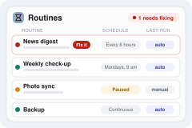

  

# Routines

  

Didn't work? Create a Studio workspace and paste this to your agent:
` /use-template https://github.com/nicholasgjokaj-star/routines`

## Why you care

One window showing everything in your workspace that runs on its own. Every scheduled task is picked up automatically, with nothing to set up, and shows its schedule, whether it is working, when it last ran, and whether that run was automatic or manual -- with fix, pause, and reschedule controls.

Anything in your workspace that runs on its own -- a nightly sync, an hourly
pull, a backup -- fails silently: you only find out when the data it feeds goes
stale. Routines shows all of them in one place, so you can see at a glance what
runs, how often, and whether it is still working.

## How to use it

Open **Routines** from the desktop. Every routine in the workspace is listed,
grouped into your apps' routines, your own automations, and built-in system
ones, with problems sorted to the top.

Each row shows:

| Column | What it tells you |
| --- | --- |
| Name and sentence | What the routine does, in plain English |
| Schedule | How often it runs ("Every day at 7:00 am", "Every 6 hours") and when it runs next |
| Status | Working, Failing (with how long and how many tries), Paused, Stopped, or Sample data |
| Last run | When it last ran, and whether that run was automatic or you started it |

From a row you can:

- **Run now** -- start it immediately; the run is recorded as manual and counts
  toward its schedule, so the next automatic run does not repeat it.
- **Pause / Resume** -- stop it from running without deleting it.
- **Change how often** -- pick a number and a unit ("every 2 hours", "every
  1 day"), and for daily or slower jobs the hour it should run at.
- **See the output** -- the recent runs with their output, the log, and the raw
  schedule entry it came from.
- **Fix it** -- on a failing routine, opens a chat that already has the
  failure, the command, and the error output, so the agent can start fixing
  rather than asking you what went wrong.

You never register anything. Every scheduled task in the workspace is found
automatically -- when you or your agent add one, it appears on the next
refresh, already showing its schedule; the workspace's instructions tell the agent to
wrap new jobs in the run recorder so their history and automatic/manual tag
show up too.

## Ideas for making it yours

- Write a one-sentence description for each of your routines in
  `catalog.toml`, so the list reads in your own words instead of job ids.
- Have a weekly routine post a summary of anything that failed in the last
  seven days to your chat or to Slack.
- Add a "quiet hours" rule that pauses noisy routines overnight and resumes
  them in the morning.
- Show a small sparkline of each routine's last 20 runs, so a flaky job stands
  out from one that broke once.
- Group routines by the app they belong to and add a "pause everything for
  this app" switch.

## What this is

This repository is a published **Imbue Studio template**: a clean, bootable
snapshot of what an agent built, ready to adapt into your own. It is NOT the
generic workspace template -- it is this specific project.

[`template.md`](template.md) is the full manifest -- what it is, how it
works, what it needs to run, and what to adapt -- with the
machine-readable half (recipe, requirements, and the environment it needs
installed) in [`template.toml`](template.toml).
